# 📘 MANUAL COMPLETO DE POSTGRESQL
## De Cero a Experto — Edición para Programadores Principiantes

---
## 🔗 Versión Web HTML Navegable: 🪄 https://metb2627.github.io/PostgreSQL-gu-a-desde-cero/

---

> **Nota de diseño del documento**
> Este manual ha sido maquetado conceptualmente siguiendo una línea editorial profesional inspirada en la paleta **Amazon** (🟦 azul marino oscuro `#131921` / `#232F3E` para encabezados y estructura, 🟧 naranja `#FF9900` para acentos, alertas y botones de acción).
>
> **Especificaciones tipográficas aplicadas** (para exportación a Word/PDF):
> | Elemento | Tamaño | Estilo |
> |---|---|---|
> | Título del manual | 16 pt | Negrita, azul marino |
> | Título 1 (Capítulo) | 14 pt | Negrita, azul marino, borde inferior naranja |
> | Título 2 (Sección) | 12 pt | Negrita, azul marino |
> | Subtítulo | 11 pt | Semi-negrita, gris oscuro |
> | Texto normal | 10 pt | Regular, interlineado sencillo |
> | Espaciado | Automático anterior | Sin espacio manual añadido |
>
> **Indicadores de criticidad** usados en todo el manual:
> 🟢 **BUENA PRÁCTICA** · 🟡 **ATENCIÓN** · 🔴 **CRÍTICO / ERROR COMÚN** · 🔵 **INFORMACIÓN ADICIONAL**
>
> Las imágenes del manual se presentan como **diagramas vectoriales esquemáticos** (notación Mermaid/ASCII-art) para garantizar legibilidad en cualquier visor Markdown y máxima nitidez a cualquier tamaño de pantalla.

---

## 🗂️ ÍNDICE GENERAL

**PARTE I — FUNDAMENTOS**
1. Introducción a las Bases de Datos y los SGBD
2. Instalación y Configuración de PostgreSQL

**PARTE II — SQL ESENCIAL**
3. Primeros Pasos con SQL: Definición de Datos (DDL)
4. Manipulación de Datos (DML): CRUD
5. Consultas Avanzadas: JOINs, Subconsultas y Agregación

**PARTE III — PROGRAMACIÓN AVANZADA EN POSTGRESQL**
6. PL/pgSQL y Procedimientos Almacenados
7. PostgreSQL como ORDBMS (Sistema de Gestión de Bases de Datos Objeto-Relacional)

**PARTE IV — CONECTIVIDAD DESDE APLICACIONES**
8. JDBC (Java Database Connectivity): Conexión desde Java
9. Transacciones y Buenas Prácticas de Programación

**PARTE V — ADMINISTRACIÓN Y HERRAMIENTAS**
10. Herramientas Gráficas: PgAdmin4 e IntelliJ IDEA
11. Seguridad, Rendimiento y Buenas Prácticas Profesionales

**CIERRE**
12. Glosario General de Términos
13. Resumen Ejecutivo Final
14. Bibliografía y Recursos Oficiales

---
---

# PARTE I — FUNDAMENTOS

# Capítulo 1. Introducción a las Bases de Datos y los SGBD

## 1.1. ¿Qué es una base de datos?

Una **base de datos** es una colección organizada de información almacenada y accesible electrónicamente desde un sistema informático. Cuando esta información crece en volumen y complejidad, su diseño requiere técnicas formales de modelado (como el modelo entidad-relación).

Piensa en una base de datos como un **archivador digital gigantesco**: en lugar de carpetas físicas con papeles, tenemos tablas con filas y columnas, pero con la ventaja de poder buscar, relacionar y modificar miles de millones de registros en milisegundos.

## 1.2. ¿Qué es un SGBD (Sistema de Gestión de Bases de Datos)?

El **SGBD**, también llamado **DBMS** (*Database Management System*, Sistema de Gestión de Bases de Datos), es el software intermedio que interactúa con los usuarios finales, las aplicaciones y la propia base de datos para capturar, organizar y analizar los datos. El SGBD también incluye las herramientas necesarias para administrar dicha base de datos.

Al conjunto formado por la base de datos + el SGBD + las aplicaciones asociadas se le denomina **sistema de base de datos**, aunque coloquialmente usamos "base de datos" para referirnos a cualquiera de estos tres elementos.

### Diagrama esquemático: Arquitectura general de un SGBD

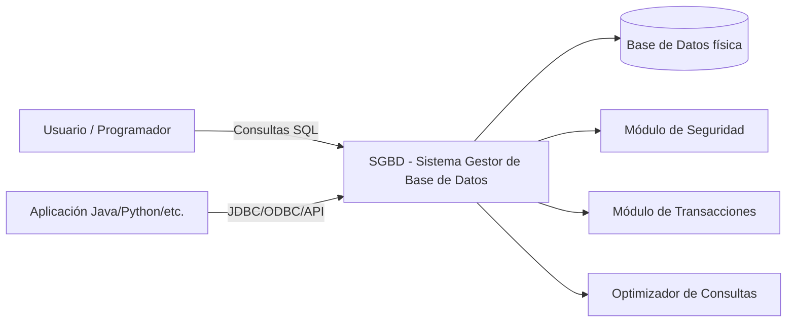

## 1.3. Principales SGBD del mercado

| SGBD | Tipo de licencia | Uso típico | Observaciones |
|---|---|---|---|
| **Oracle Database** | Comercial | Grandes corporaciones | Muy robusto, licencias costosas |
| **Microsoft SQL Server** | Comercial | Entornos empresariales Windows | Fuerte integración con .NET |
| **MySQL** | Open Source (con edición comercial) | Aplicaciones web | Muy extendido en hosting |
| **SQLite** | Open Source | Aplicaciones embebidas (móviles) | Base de datos en un solo archivo |
| **PostgreSQL** | Open Source (licencia PostgreSQL, tipo BSD/MIT) | Multiplataforma, empresarial y académico | Soporte objeto-relacional, muy extensible |

🔵 **INFORMACIÓN ADICIONAL**: A lo largo de este manual trabajaremos con **PostgreSQL** por ser gratuito, multiplataforma (Windows, Linux, macOS, FreeBSD, OpenBSD) y por ofrecer características avanzadas de orientación a objetos poco comunes en otros SGBD relacionales.

## 1.4. Formas de conectar una aplicación a un SGBD

Existen tres grandes estrategias para que un programa se comunique con una base de datos:

1. **Bases de datos embebidas**: la conexión entre el programa y la base de datos es directa. Ofrece máxima velocidad, pero si cambiamos de SGBD habrá que reescribir buena parte de la aplicación. 🔴 **CRÍTICO**: poco recomendable para aplicaciones que deban ser portables.

2. **API (Application Programming Interface — Interfaz de Programación de Aplicaciones) genérica**: permite conectar de manera uniforme con distintos SGBD. El estándar más extendido es **ODBC** (*Open Database Connectivity* — Conectividad Abierta a Bases de Datos), muy usado en C, C++, C# y Visual Basic.

3. **API nativa orientada a objetos**: en el mundo Java, ODBC resulta inadecuado porque se apoya en llamadas al estilo C (con punteros, inexistentes en Java), lo que genera riesgos de seguridad y poca robustez. Por ello se emplea **JDBC** (*Java Database Connectivity* — Conectividad a Bases de Datos desde Java), una alternativa totalmente orientada a objetos.

### Diagrama: Vías de conexión a una base de datos

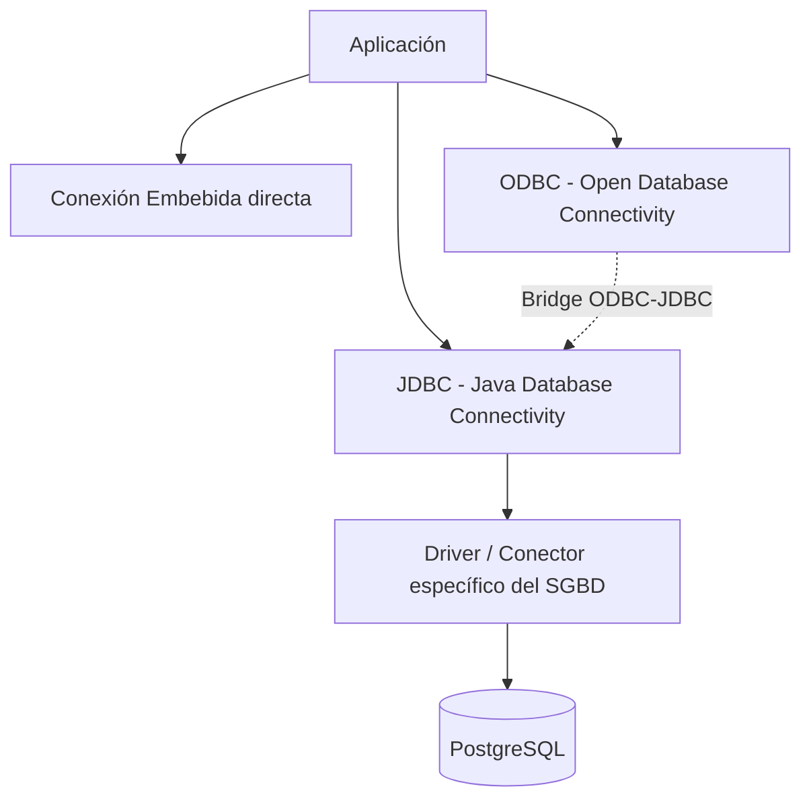

Para usar JDBC necesitaremos instalar un **driver** (también llamado **conector**) específico del SGBD al que queramos acceder. Si no existe un driver JDBC nativo pero sí uno ODBC, se puede recurrir a un **puente ODBC-JDBC**.

## 📋 Tabla Resumen del Capítulo 1

| Concepto | Definición breve |
|---|---|
| Base de datos | Colección organizada de datos accesibles electrónicamente |
| SGBD (DBMS) | Software que gestiona el acceso, almacenamiento y seguridad de los datos |
| ODBC | Estándar de conectividad genérica, usado en C/C++/C#/VB |
| JDBC | Estándar de conectividad orientado a objetos para Java |
| Driver/Conector | Software que traduce las llamadas JDBC/ODBC al protocolo propio del SGBD |

## ❓ Cuestionario de Autoevaluación — Capítulo 1

1. ¿Qué diferencia principal existe entre una base de datos y un SGBD?
2. ¿Por qué ODBC no es la opción recomendada al trabajar en Java?
3. ¿Cómo se denomina habitualmente al driver JDBC en el mundo Java?
4. Cita dos SGBD orientados al uso empresarial de pago.
5. ¿Qué SGBD es ampliamente usado para aplicaciones móviles embebidas?
6. ¿Qué ventaja tiene una conexión embebida directa? ¿Y qué desventaja?
7. ¿Qué significan las siglas API?
8. ¿Qué es un "puente ODBC-JDBC" y cuándo se utiliza?
9. ¿Qué licencia tiene PostgreSQL?
10. Menciona dos sistemas operativos donde PostgreSQL puede ejecutarse de forma nativa.

### ✅ Respuestas

1. La base de datos es el conjunto de datos almacenados; el SGBD es el software que gestiona el acceso, administración y seguridad de esos datos.
2. Porque ODBC se basa en llamadas al estilo C que usan punteros (inexistentes en Java), lo que genera riesgos de seguridad y falta de robustez.
3. "Driver" o "conector" (*connector*).
4. Oracle Database y Microsoft SQL Server.
5. SQLite.
6. Ventaja: máxima velocidad de comunicación. Desventaja: poca portabilidad entre distintos SGBD.
7. *Application Programming Interface* (Interfaz de Programación de Aplicaciones).
8. Es un adaptador que permite usar JDBC cuando únicamente existe un driver ODBC disponible para el SGBD. Se usa cuando no hay driver JDBC nativo.
9. Licencia de código abierto (tipo BSD/MIT, conocida como "Licencia PostgreSQL").
10. Windows, Linux, macOS (también FreeBSD y OpenBSD).

---

# Capítulo 2. Instalación y Configuración de PostgreSQL

## 2.1. ¿Qué es PostgreSQL?

**PostgreSQL**, también conocido como **Postgres**, es un **RDBMS** (*Relational Database Management System* — Sistema de Gestión de Bases de Datos Relacionales) libre y de código abierto, centrado en la extensibilidad y el cumplimiento del estándar SQL (*Structured Query Language* — Lenguaje de Consulta Estructurado).

### 🕰️ Breve historia

- Nació como sucesor del proyecto **Ingres**, desarrollado en la Universidad de California, Berkeley, bajo el nombre **POSTGRES**.
- En **1996** el proyecto se renombra **PostgreSQL** para reflejar su soporte de SQL.
- Tras una revisión en **2007**, el equipo de desarrollo decide mantener el nombre PostgreSQL, aceptando también el alias "Postgres".

## 2.2. Características principales

PostgreSQL ofrece:

- Transacciones con propiedades **ACID** (*Atomicity, Consistency, Isolation, Durability* — Atomicidad, Consistencia, Aislamiento y Durabilidad).
- Vistas actualizables automáticamente y **vistas materializadas**.
- **Triggers** (disparadores).
- **Claves foráneas** (*foreign keys*).
- **Procedimientos almacenados** (*stored procedures*).
- Capacidad para manejar desde una única máquina hasta grandes almacenes de datos (*data warehouses*) o servicios web con múltiples usuarios concurrentes.
- Es el SGBD por defecto de macOS Server, y está disponible también para Windows, Linux, FreeBSD y OpenBSD.

🟢 **BUENA PRÁCTICA**: Elegir PostgreSQL para proyectos académicos y profesionales que requieran portabilidad entre sistemas operativos y funciones avanzadas (tipos de datos personalizados, JSON, herencia de tablas).

## 2.3. Instalación paso a paso

### Windows

1. Descargar el instalador desde el sitio oficial (`https://www.postgresql.org/download/`).
2. Ejecutar el asistente y seleccionar la ruta de instalación.
3. Establecer la contraseña del superusuario `postgres`.
4. Confirmar el puerto por defecto: **5432**.
5. **Paso crítico** 🔴: en la última pantalla del instalador, **marcar la casilla para lanzar Stack Builder**, ya que es obligatorio ejecutarlo para instalar los drivers JDBC.

```
┌───────────────────────────────────────────┐
│   Completando el asistente de PostgreSQL   │
│                                             │
│   [x] Lanzar Stack Builder al salir        │
│       (necesario para instalar el driver   │
│        JDBC)                               │
└───────────────────────────────────────────┘
```

6. Dentro de Stack Builder: `Categorías → Database Drivers → pgJDBC` y marcar la casilla correspondiente.
7. Aceptar los valores por defecto tanto de PostgreSQL como del driver JDBC.

### Linux (Debian/Ubuntu, resumen de comandos)

```bash
sudo apt update
sudo apt install postgresql postgresql-contrib
sudo systemctl start postgresql
sudo systemctl enable postgresql
```

### macOS

```bash
brew install postgresql
brew services start postgresql
```

## 2.4. PgAdmin4: la herramienta gráfica de administración

Se recomienda encarecidamente el uso de **PgAdmin4** para gestionar visualmente bases de datos, tablas, usuarios, roles y consultas SQL mediante su **Query Tool**.

### Diagrama: Flujo de instalación de PostgreSQL + driver JDBC

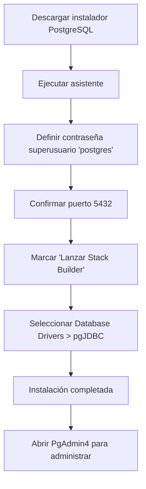

## 📋 Tabla Resumen del Capítulo 2

| Elemento | Valor / Detalle |
|---|---|
| Nombre original | POSTGRES (sucesor de Ingres, Berkeley) |
| Año de renombrado | 1996 → PostgreSQL |
| Licencia | Código abierto |
| Puerto por defecto | 5432 |
| Usuario administrador por defecto | postgres |
| Herramienta gráfica recomendada | PgAdmin4 |
| Herramienta obligatoria para JDBC | Stack Builder |

## 2.5. Actividades Propuestas

1. Usando **PgAdmin4**, crear una base de datos llamada `VTInstitute` (*Vocational Training Institute*). Dentro, crear una tabla `subjects` con tres campos:
   - `code`: campo de tipo secuencia (investiga qué es un *sequence* en PostgreSQL).
   - `name`: cadena de texto de máximo 50 caracteres.
   - `year`: entero que indica el año en que se cursa la asignatura.
2. Usando el **Query Tool** de PgAdmin y la cláusula `INSERT`, añadir estos registros a `subjects`:
   - `'DATA ACCESS'`, segundo año
   - `'DEVELOPMENT ENVIRONMENTS'`, primer año
   - `'DATABASE MANAGEMENT SYSTEMS'`, primer año
   - `'SERVICES AND PROCESSES'`, segundo año
3. Crear una base de datos `employees`. Descargar y ejecutar el script `employee-dept.sql`, verificando que se crean correctamente dos tablas con registros.

## ❓ Cuestionario de Autoevaluación — Capítulo 2

1. ¿Qué significan las siglas ACID?
2. ¿Cuál es el puerto por defecto de PostgreSQL?
3. ¿Por qué es obligatorio ejecutar Stack Builder durante la instalación en Windows?
4. ¿Qué herramienta gráfica se recomienda para administrar PostgreSQL?
5. ¿En qué universidad se originó el predecesor de PostgreSQL?
6. ¿Cómo se llamaba el proyecto antes de adoptar el nombre PostgreSQL?
7. ¿En qué sistema operativo es PostgreSQL la base de datos por defecto?
8. ¿Qué comando se usa en Ubuntu/Debian para instalar PostgreSQL vía terminal?
9. ¿Qué es una vista materializada?
10. Nombra tres características avanzadas que ofrece PostgreSQL además del modelo relacional puro.

### ✅ Respuestas

1. Atomicity, Consistency, Isolation, Durability (Atomicidad, Consistencia, Aislamiento, Durabilidad).
2. El puerto 5432.
3. Porque es la vía para instalar los drivers JDBC necesarios para conectar aplicaciones Java a PostgreSQL.
4. PgAdmin4.
5. Universidad de California, Berkeley.
6. POSTGRES (como sucesor de Ingres).
7. macOS Server.
8. `sudo apt install postgresql postgresql-contrib`.
9. Una vista cuyo resultado se almacena físicamente y debe actualizarse explícitamente, a diferencia de una vista normal que se recalcula en cada consulta.
10. Triggers, procedimientos almacenados, herencia de tablas, tipos de datos personalizados (dominios, compuestos, enumerados, arrays), soporte JSON/XML (cualquiera de estas es válida).

---
---

# PARTE II — SQL ESENCIAL

# Capítulo 3. Primeros Pasos con SQL: Definición de Datos (DDL)

## 3.1. ¿Qué es SQL?

**SQL** (*Structured Query Language* — Lenguaje de Consulta Estructurado) es el lenguaje estándar para interactuar con bases de datos relacionales. Se divide tradicionalmente en subconjuntos:

| Subconjunto | Significado | Ejemplos de sentencias |
|---|---|---|
| **DDL** | *Data Definition Language* (Lenguaje de Definición de Datos) | `CREATE`, `ALTER`, `DROP` |
| **DML** | *Data Manipulation Language* (Lenguaje de Manipulación de Datos) | `SELECT`, `INSERT`, `UPDATE`, `DELETE` |
| **DCL** | *Data Control Language* (Lenguaje de Control de Datos) | `GRANT`, `REVOKE` |
| **TCL** | *Transaction Control Language* (Lenguaje de Control de Transacciones) | `COMMIT`, `ROLLBACK` |

## 3.2. Creación de bases de datos

```sql
CREATE DATABASE "VTInstitute";
```

## 3.3. Creación de tablas

La sentencia `CREATE TABLE` define la estructura de una tabla: nombre de columnas, tipos de datos y restricciones.

```sql
CREATE TABLE subjects (
    code   SERIAL PRIMARY KEY,
    name   VARCHAR(50) NOT NULL,
    year   INTEGER NOT NULL
);
```

🔵 **INFORMACIÓN ADICIONAL**: `SERIAL` es un pseudo-tipo propio de PostgreSQL que crea automáticamente una **secuencia** (*sequence*) asociada a la columna, generando valores autoincrementales (1, 2, 3…) cada vez que se inserta una fila sin especificar ese valor.

## 3.4. Tipos de datos más comunes en PostgreSQL

| Tipo | Descripción | Ejemplo |
|---|---|---|
| `INTEGER` / `INT` | Número entero | `25` |
| `SERIAL` | Entero autoincremental (secuencia) | `1, 2, 3...` |
| `VARCHAR(n)` | Cadena de texto de longitud variable máxima `n` | `'Data Access'` |
| `TEXT` | Cadena de texto de longitud ilimitada | `'Descripción larga...'` |
| `BOOLEAN` | Verdadero/falso | `TRUE` / `FALSE` |
| `DATE` | Fecha | `'2024-05-31'` |
| `TIMESTAMP` | Fecha y hora | `'2024-05-31 10:00:00'` |
| `NUMERIC(p,s)` | Número decimal de precisión exacta | `1234.56` |
| `FLOAT` / `DOUBLE PRECISION` | Número decimal de coma flotante | `3.14159` |

## 3.5. Restricciones (*Constraints*)

| Restricción | Función |
|---|---|
| `PRIMARY KEY` | Identifica de forma única cada fila |
| `FOREIGN KEY` | Relaciona una columna con la clave primaria de otra tabla |
| `NOT NULL` | Impide valores nulos |
| `UNIQUE` | Impide valores duplicados |
| `CHECK` | Valida una condición lógica sobre el valor |
| `DEFAULT` | Asigna un valor por defecto |

### Ejemplo con clave foránea (FK)

```sql
CREATE TABLE courses (
    code SERIAL PRIMARY KEY,
    name VARCHAR(90) NOT NULL
);

ALTER TABLE subjects
    ADD COLUMN course INTEGER;

ALTER TABLE subjects
    ADD CONSTRAINT fk_course
    FOREIGN KEY (course) REFERENCES courses(code);
```

### Diagrama: Relación Entidad-Relación simplificada

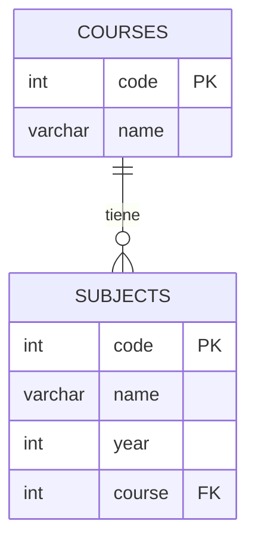

## 3.6. Modificar y eliminar estructuras

```sql
-- Añadir columna
ALTER TABLE subjects ADD COLUMN hours INTEGER;

-- Eliminar columna
ALTER TABLE subjects DROP COLUMN hours;

-- Eliminar tabla
DROP TABLE subjects;
```

## 📋 Tabla Resumen del Capítulo 3

| Comando | Propósito |
|---|---|
| `CREATE DATABASE` | Crea una base de datos |
| `CREATE TABLE` | Define una nueva tabla |
| `ALTER TABLE` | Modifica la estructura de una tabla existente |
| `DROP TABLE` | Elimina una tabla |
| `SERIAL` | Tipo autoincremental basado en secuencias |

## ❓ Cuestionario de Autoevaluación — Capítulo 3

1. ¿Qué significan las siglas DDL y DML?
2. ¿Qué hace el tipo `SERIAL` en PostgreSQL?
3. ¿Cuál es la diferencia entre `VARCHAR(n)` y `TEXT`?
4. Escribe la sentencia SQL para crear una tabla `students` con `id` (serie autoincremental, clave primaria) y `name` (texto de hasta 60 caracteres, obligatorio).
5. ¿Qué restricción impide la existencia de valores repetidos en una columna?
6. ¿Qué hace la restricción `CHECK`?
7. ¿Qué comando se usa para añadir una columna nueva a una tabla ya creada?
8. ¿Qué es una clave foránea (`FOREIGN KEY`)?
9. ¿Qué ocurre si intentamos eliminar una tabla referenciada por una clave foránea de otra tabla sin tomar precauciones?
10. ¿Qué subconjunto de SQL incluye `GRANT` y `REVOKE`?

### ✅ Respuestas

1. DDL: *Data Definition Language* (Lenguaje de Definición de Datos); DML: *Data Manipulation Language* (Lenguaje de Manipulación de Datos).
2. Crea automáticamente una secuencia que genera valores enteros autoincrementales para esa columna.
3. `VARCHAR(n)` limita la longitud máxima a `n` caracteres; `TEXT` no tiene límite de longitud predefinido.
4. `CREATE TABLE students (id SERIAL PRIMARY KEY, name VARCHAR(60) NOT NULL);`
5. `UNIQUE`.
6. Valida que los valores introducidos cumplan una condición lógica definida (por ejemplo, `CHECK (price > 0)`).
7. `ALTER TABLE nombre_tabla ADD COLUMN ...;`
8. Es una columna (o conjunto de columnas) que referencia la clave primaria de otra tabla, garantizando integridad referencial.
9. PostgreSQL lanzará un error impidiendo la eliminación, a menos que se use `CASCADE` o se elimine primero la restricción/relación.
10. DCL (*Data Control Language* — Lenguaje de Control de Datos).

---

# Capítulo 4. Manipulación de Datos (DML): Operaciones CRUD

**CRUD** son las siglas de *Create, Read, Update, Delete* (Crear, Leer, Actualizar, Eliminar), las cuatro operaciones básicas sobre datos.

## 4.1. INSERT — Crear registros

```sql
INSERT INTO subjects (name, year)
VALUES ('DATA ACCESS', 2),
       ('DEVELOPMENT ENVIRONMENTS', 1),
       ('DATABASE MANAGEMENT SYSTEMS', 1),
       ('SERVICES AND PROCESSES', 2);
```

🟢 **BUENA PRÁCTICA**: No es necesario indicar el valor de `code` porque es `SERIAL`; PostgreSQL lo generará automáticamente.

## 4.2. SELECT — Leer registros

```sql
SELECT * FROM subjects;

SELECT name, year FROM subjects
WHERE year = 1
ORDER BY name ASC;
```

### Cláusulas más usadas con SELECT

| Cláusula | Función |
|---|---|
| `WHERE` | Filtra filas según una condición |
| `ORDER BY` | Ordena el resultado |
| `LIMIT` | Limita el número de filas devueltas |
| `DISTINCT` | Elimina filas duplicadas |
| `GROUP BY` | Agrupa filas para cálculos agregados |
| `HAVING` | Filtra grupos (usado junto a `GROUP BY`) |

## 4.3. UPDATE — Actualizar registros

```sql
UPDATE subjects
SET year = 2
WHERE name = 'DEVELOPMENT ENVIRONMENTS';
```

🔴 **CRÍTICO**: Olvidar la cláusula `WHERE` en un `UPDATE` provoca que **todas las filas** de la tabla se actualicen. Siempre verifica la condición antes de ejecutar.

## 4.4. DELETE — Eliminar registros

```sql
DELETE FROM subjects
WHERE code = 5;
```

🔴 **CRÍTICO**: Igual que con `UPDATE`, un `DELETE` sin `WHERE` borra **todos** los registros de la tabla.

### Diagrama: Ciclo de vida CRUD

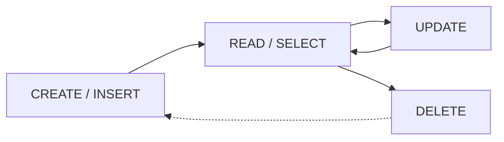

## 📋 Tabla Resumen del Capítulo 4

| Operación | Sentencia SQL | Riesgo principal |
|---|---|---|
| Crear | `INSERT` | Violación de restricciones (`NOT NULL`, `UNIQUE`, `FK`) |
| Leer | `SELECT` | Rendimiento en consultas mal indexadas |
| Actualizar | `UPDATE` | Modificación masiva sin `WHERE` |
| Eliminar | `DELETE` | Borrado masivo sin `WHERE` |

## 4.5. Actividades Propuestas

1. Usando `executeUpdate` desde Java (se explicará en el Capítulo 8), inserta una nueva asignatura (`'Markup Languages'`, primer año) y muestra por pantalla el valor devuelto por el método.
2. Usando `execute` o `executeUpdate`, altera la tabla `subjects` para añadir una nueva columna `hours` (entero) que represente las horas anuales de la asignatura.

## ❓ Cuestionario de Autoevaluación — Capítulo 4

1. ¿Qué significan las siglas CRUD?
2. ¿Qué sentencia SQL se usa para insertar nuevas filas?
3. ¿Qué ocurre si ejecutamos un `DELETE FROM tabla;` sin cláusula `WHERE`?
4. ¿Para qué sirve `ORDER BY`?
5. ¿Cuál es la diferencia entre `WHERE` y `HAVING`?
6. ¿Qué hace la cláusula `DISTINCT`?
7. Escribe una sentencia que actualice el campo `year` a `2` para la asignatura con `code = 3`.
8. ¿Qué cláusula limita el número de resultados devueltos por una consulta?
9. ¿Por qué es recomendable usar `PreparedStatement` en lugar de concatenar cadenas SQL (se amplía en el Capítulo 8)?
10. ¿Qué devuelve `SELECT COUNT(*) FROM subjects;`?

### ✅ Respuestas

1. *Create, Read, Update, Delete* (Crear, Leer, Actualizar, Eliminar).
2. `INSERT INTO`.
3. Se eliminan todas las filas de la tabla.
4. Para ordenar el resultado de una consulta según una o varias columnas.
5. `WHERE` filtra filas individuales antes de agrupar; `HAVING` filtra grupos después de aplicar `GROUP BY`.
6. Elimina filas duplicadas del resultado.
7. `UPDATE subjects SET year = 2 WHERE code = 3;`
8. `LIMIT`.
9. Porque previene ataques de inyección SQL y mejora el rendimiento en ejecuciones repetidas.
10. El número total de filas de la tabla `subjects`.

---

# Capítulo 5. Consultas Avanzadas: JOINs, Subconsultas y Agregación

## 5.1. JOINs — Combinando tablas

Un **JOIN** combina filas de dos o más tablas basándose en una columna relacionada (normalmente una clave foránea).

| Tipo de JOIN | Descripción |
|---|---|
| `INNER JOIN` | Devuelve solo las filas con coincidencia en ambas tablas |
| `LEFT JOIN` | Devuelve todas las filas de la tabla izquierda, con `NULL` si no hay coincidencia |
| `RIGHT JOIN` | Devuelve todas las filas de la tabla derecha, con `NULL` si no hay coincidencia |
| `FULL JOIN` | Devuelve todas las filas de ambas tablas, coincidan o no |

```sql
SELECT subjects.name, courses.name AS course_name
FROM subjects
INNER JOIN courses ON subjects.course = courses.code;
```

### Diagrama: Tipos de JOIN

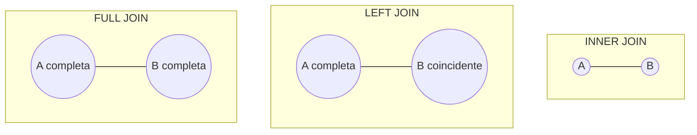

## 5.2. Funciones de agregación

| Función | Resultado |
|---|---|
| `COUNT(*)` | Número de filas |
| `SUM(columna)` | Suma de valores |
| `AVG(columna)` | Promedio |
| `MAX(columna)` | Valor máximo |
| `MIN(columna)` | Valor mínimo |

```sql
SELECT year, COUNT(*) AS total_subjects
FROM subjects
GROUP BY year;
```

## 5.3. Subconsultas

Una **subconsulta** es una consulta anidada dentro de otra.

```sql
SELECT name
FROM subjects
WHERE course IN (
    SELECT code FROM courses WHERE name = 'Web development'
);
```

## 5.4. Vistas (VIEW)

Una **vista** es una consulta almacenada que se comporta como una tabla virtual, permitiendo abstracción de los datos reales.

```sql
CREATE VIEW subjects_per_year AS
SELECT year, COUNT(*) AS total
FROM subjects
GROUP BY year;

SELECT * FROM subjects_per_year;
```

🟢 **BUENA PRÁCTICA**: Las vistas permiten crear una "API de datos" que oculta la complejidad del modelo físico, facilitando el mantenimiento de aplicaciones.

## 5.5. Índices

Un **índice** acelera la búsqueda de filas en una tabla, a costa de un ligero sobrecoste en las operaciones de escritura.

```sql
CREATE INDEX idx_subjects_name ON subjects(name);
```

## 📋 Tabla Resumen del Capítulo 5

| Elemento | Uso principal |
|---|---|
| `INNER JOIN` | Combinar tablas relacionadas por coincidencia |
| `LEFT/RIGHT JOIN` | Incluir filas sin coincidencia |
| `GROUP BY` + agregación | Resúmenes estadísticos |
| Subconsulta | Consulta dentro de otra consulta |
| `VIEW` | Abstracción de datos, consulta reutilizable |
| `INDEX` | Mejorar el rendimiento de búsquedas |

## ❓ Cuestionario de Autoevaluación — Capítulo 5

1. ¿Qué diferencia hay entre `INNER JOIN` y `LEFT JOIN`?
2. ¿Qué función de agregación cuenta el número de filas?
3. ¿Qué es una subconsulta?
4. ¿Qué es una vista (`VIEW`) y qué ventaja aporta?
5. Escribe una consulta que calcule el promedio de `year` en la tabla `subjects`.
6. ¿Para qué sirve un índice (`INDEX`)?
7. ¿Qué cláusula se usa junto a `GROUP BY` para filtrar grupos?
8. ¿Qué devuelve un `FULL JOIN`?
9. ¿Qué inconveniente puede tener crear demasiados índices en una tabla?
10. ¿Qué palabra clave se usa para dar un alias a una columna o tabla en una consulta?

### ✅ Respuestas

1. `INNER JOIN` solo devuelve filas coincidentes en ambas tablas; `LEFT JOIN` devuelve todas las filas de la tabla izquierda, aunque no tengan coincidencia (rellenando con `NULL`).
2. `COUNT(*)`.
3. Una consulta anidada dentro de otra consulta SQL.
4. Es una consulta almacenada que actúa como tabla virtual; permite abstraer y simplificar el acceso a los datos.
5. `SELECT AVG(year) FROM subjects;`
6. Acelerar las búsquedas y ordenaciones sobre una columna.
7. `HAVING`.
8. Todas las filas de ambas tablas, tengan o no coincidencia.
9. Ralentiza las operaciones de inserción, actualización y borrado, además de ocupar espacio adicional en disco.
10. `AS`.

---
---

# PARTE III — PROGRAMACIÓN AVANZADA EN POSTGRESQL

# Capítulo 6. PL/pgSQL y Procedimientos Almacenados

## 6.1. ¿Qué es PL/pgSQL?

**PL/pgSQL** (*Procedural Language/PostgreSQL* — Lenguaje Procedimental de PostgreSQL) es el lenguaje de programación propio de PostgreSQL que permite escribir **funciones** y **procedimientos almacenados** (*stored procedures*) ejecutados directamente en el motor de la base de datos.

### Diferencia entre función y procedimiento

| Concepto | ¿Devuelve valor? | Palabra clave |
|---|---|---|
| **Función** | Sí (un valor o un conjunto de filas) | `CREATE FUNCTION` |
| **Procedimiento** | No necesariamente | `CREATE PROCEDURE` |

## 6.2. Estructura básica de una función

```sql
CREATE [OR REPLACE] FUNCTION function_name (arguments)
RETURNS return_datatype
LANGUAGE 'plpgsql'
AS $BODY$
DECLARE
    declaration;
BEGIN
    < cuerpo de la función >
    RETURN { valor | NEXT };
END;
$BODY$;
```

## 6.3. Estructura básica de un procedimiento

```sql
CREATE [OR REPLACE] PROCEDURE procedure_name (arguments)
LANGUAGE 'plpgsql'
AS $BODY$
DECLARE
    declaration;
BEGIN
    < cuerpo del procedimiento >
END;
$BODY$;
```

## 6.4. Ejemplo práctico: contar asignaturas por año

```sql
CREATE OR REPLACE FUNCTION public.subjectsinyear(theyear integer)
    RETURNS integer
    LANGUAGE 'plpgsql'
AS $BODY$
DECLARE
    amount INTEGER;
BEGIN
    SELECT COUNT(*) INTO amount FROM subjects WHERE subjects.year = theyear;
    RETURN amount;
END;
$BODY$;
```

Invocación desde el **Query Tool** de PgAdmin4:

```sql
SELECT subjectsinyear(1);
```

🔵 **INFORMACIÓN ADICIONAL**: Si se define la función usando el asistente gráfico de PgAdmin4, la definición se divide en dos pestañas: **Definition** (cabecera: tipo de retorno, lenguaje, argumentos) y **Code** (el cuerpo `DECLARE...BEGIN...END`).

## 6.5. Retorno de conjuntos de filas: `SETOF`

Cuando una función debe devolver múltiples filas, se emplea `RETURNS SETOF`:

```sql
CREATE OR REPLACE FUNCTION listofsubjects(theyear integer)
    RETURNS SETOF subjects
    LANGUAGE 'plpgsql'
AS $BODY$
DECLARE
    mysubject subjects;
BEGIN
    FOR mysubject IN SELECT * FROM subjects WHERE year = theyear
    LOOP
        RETURN NEXT mysubject;
    END LOOP;
END;
$BODY$;
```

Versión simplificada con `RETURN QUERY`:

```sql
CREATE OR REPLACE FUNCTION listofsubjects(theyear integer)
    RETURNS SETOF subjects
    LANGUAGE 'plpgsql'
AS $BODY$
BEGIN
    RETURN QUERY
        SELECT * FROM subjects WHERE year = theyear;
END;
$BODY$;
```

## 6.6. Tipos de retorno personalizados: `CREATE TYPE`

Si no necesitamos devolver la fila completa, podemos definir un tipo a medida, similar a crear una vista parcial:

```sql
CREATE TYPE subjects_with_courses AS (
    name   VARCHAR(50),
    course VARCHAR(90)
);

CREATE OR REPLACE FUNCTION public.subjects_and_courses(theyear integer)
    RETURNS SETOF subjects_with_courses
    LANGUAGE 'plpgsql'
AS $BODY$
DECLARE
    mysubject subjects_with_courses;
BEGIN
    FOR mysubject IN
        SELECT subjects.name, courses.name
        FROM subjects INNER JOIN courses ON subjects.course = courses.code
        WHERE year = theyear
    LOOP
        RETURN NEXT mysubject;
    END LOOP;
END;
$BODY$;
```

## 6.7. Definición de tabla en línea: `RETURNS TABLE`

Alternativa sin necesidad de crear un tipo previo:

```sql
CREATE OR REPLACE FUNCTION public.subjects_and_courses_2(theyear integer)
    RETURNS TABLE(name VARCHAR(50), course VARCHAR(90))
    LANGUAGE 'plpgsql'
AS $BODY$
DECLARE
    mysubject RECORD;
BEGIN
    FOR mysubject IN
        SELECT subjects.name AS sname, courses.name AS scourse
        FROM subjects INNER JOIN courses ON subjects.course = courses.code
        WHERE year = theyear
    LOOP
        name := mysubject.sname;
        course := mysubject.scourse;
        RETURN NEXT;
    END LOOP;
END;
$BODY$;
```

### Diagrama: Opciones para retornar datos desde una función PL/pgSQL

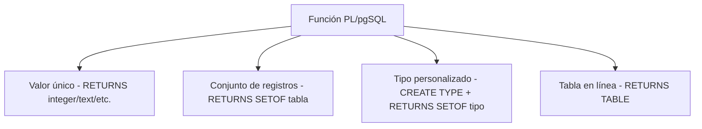

## 📋 Tabla Resumen del Capítulo 6

| Elemento | Uso |
|---|---|
| `CREATE FUNCTION` | Define una función que devuelve un valor |
| `CREATE PROCEDURE` | Define un procedimiento (no obligado a retornar valor) |
| `RETURNS SETOF` | Devuelve un conjunto de filas |
| `CREATE TYPE` | Define un tipo de dato personalizado para el retorno |
| `RETURNS TABLE` | Define la estructura de retorno "en línea" |
| `RETURN QUERY` | Atajo para devolver directamente el resultado de una consulta |

## 6.8. Actividades Propuestas

1. Usando la base de datos `employees`, crea un procedimiento almacenado que liste todos los empleados de un puesto (*job*) concreto.
2. Crea otro procedimiento que devuelva los empleados de un departamento específico (el nombre del departamento se pasa como parámetro).
3. Crea un procedimiento que liste los empleados cuyo nombre contenga un patrón pasado como parámetro.
4. Crea una aplicación Java que permita invocar cualquiera de los procedimientos anteriores (se completará en el Capítulo 8).

## ❓ Cuestionario de Autoevaluación — Capítulo 6

1. ¿Qué significan las siglas PL/pgSQL?
2. ¿Cuál es la diferencia fundamental entre una función y un procedimiento en PostgreSQL?
3. ¿Qué palabra clave se utiliza para devolver múltiples filas desde una función?
4. ¿Qué instrucción simplifica el retorno de un conjunto de filas evitando el bucle `FOR...LOOP`?
5. ¿Para qué sirve `CREATE TYPE` en el contexto de procedimientos almacenados?
6. ¿Qué alternativa a `CREATE TYPE` existe para definir la estructura de retorno sin crear un tipo separado?
7. ¿Cómo se invoca una función llamada `subjectsinyear` que recibe el parámetro `1`?
8. En PgAdmin4, ¿en qué pestaña se escribe el cuerpo `DECLARE...BEGIN...END` de una función creada con el asistente gráfico?
9. ¿Qué ventaja tiene usar procedimientos almacenados en lugar de SQL dinámico embebido en la aplicación?
10. ¿Qué tipo de dato especial, `RECORD`, se usa en el ejemplo de `RETURNS TABLE`?

### ✅ Respuestas

1. *Procedural Language/PostgreSQL* (Lenguaje Procedimental de PostgreSQL).
2. Una función está obligada a devolver un valor (escalar o conjunto); un procedimiento no tiene esa obligación.
3. `RETURNS SETOF`.
4. `RETURN QUERY`.
5. Permite definir una estructura de datos personalizada (como una mini-vista) para usarla como tipo de retorno de una función.
6. `RETURNS TABLE(columna tipo, ...)`.
7. `SELECT subjectsinyear(1);`
8. En la pestaña **Code**.
9. Mayor seguridad frente a inyección SQL, mejor rendimiento (se ejecutan en el servidor) y reutilización de lógica de negocio.
10. Es un tipo genérico que permite almacenar una fila con estructura dinámica dentro del cuerpo de la función.

---

# Capítulo 7. PostgreSQL como ORDBMS

## 7.1. ¿Qué es un ORDBMS?

Un **ORD** (*Object-Relational Database* — Base de Datos Objeto-Relacional) o **ORDBMS** (*Object-Relational Database Management System* — Sistema de Gestión de Bases de Datos Objeto-Relacional) es un SGBD similar a uno relacional, pero que soporta directamente conceptos de la **POO** (Programación Orientada a Objetos): objetos, clases y herencia, integrados en el esquema y en el lenguaje de consultas.

Un ORDBMS se sitúa en un **punto intermedio** entre las bases de datos relacionales puras y las bases de datos orientadas a objetos (**OODBMS**), que almacenan objetos de forma persistente con poco soporte de consulta declarativa.

Entre los SGBD más conocidos con soporte orientado a objetos están **Oracle**, **PostgreSQL** e **Informix**.

### Diagrama: Espectro Relacional ↔ Orientado a Objetos

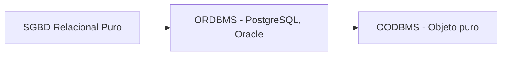

## 7.2. PostgreSQL como ORDBMS

PostgreSQL admite procedimientos almacenados escritos en lenguajes puramente procedimentales (PL/pgSQL, Perl) y en lenguajes más orientados a objetos (Python, Java) mediante módulos de terceros. Sin embargo, el almacenamiento sigue siendo **relacional**: cada relación (tabla) es una clase, pero no toda clase necesita ser una relación.

🔵 **INFORMACIÓN ADICIONAL**: PostgreSQL es un entorno **fuertemente tipado**, por lo que el polimorfismo real requiere trabajo explícito (conversiones, *casts*).

## 7.3. Abstracción y encapsulación de datos

### Vistas como API de datos

Las **vistas** permiten crear una interfaz abstraída de los datos, independiente del almacenamiento físico. Mediante el sistema de reglas (*rules*), es posible redirigir `INSERT`, `UPDATE` y `DELETE` sobre una vista hacia las tablas subyacentes.

### Campos calculados mediante funciones

Si creamos una tabla `employee` con los campos `first_name`, `middle_name`, `last_name`, y definimos una función `name(employee)` que concatena estos valores, PostgreSQL permite esta notación "orientada a objetos":

```sql
SELECT e.name FROM employee e;
```

PostgreSQL la transforma internamente en:

```sql
SELECT name(e) FROM employee e;
```

🟡 **ATENCIÓN**: Esta transformación solo ocurre si se usa la referencia a la fila completa (`e.name`); escribir `SELECT name FROM employee` **no** tendrá el mismo efecto, pues buscará una columna real llamada `name`.

## 7.4. Polimorfismo en PostgreSQL

PostgreSQL permite crear y sobrecargar operadores, así como convertir (*cast*) un tipo de dato en otro, de forma **implícita** o **explícita**.

🔴 **CRÍTICO**: Los *casts* implícitos pueden ser peligrosos. Por ejemplo, la cadena `'2012-05-31'` es una fecha válida, pero la expresión numérica `2012-05-31` (sin comillas) se evalúa aritméticamente como `2012 - 05 - 31 = 1976`. Un *cast* implícito mal diseñado podría insertar la fecha `'1976-01-01'` en lugar de `'2012-05-31'` sin lanzar ningún error.

### 7.4.1. Dominios (`DOMAIN`)

Un **dominio** es un tipo de dato definido por el usuario basado en otro tipo existente, al que opcionalmente se le añaden restricciones.

```sql
CREATE DOMAIN posint AS integer CHECK (VALUE > 0);

CREATE TABLE mytable (id posint);

INSERT INTO mytable VALUES(1);   -- funciona
INSERT INTO mytable VALUES(-1);  -- falla (viola el CHECK)
```

🔵 **INFORMACIÓN ADICIONAL**: Al aplicar un operador del tipo base sobre un dominio, el resultado se "degrada" automáticamente al tipo base. Por ejemplo, `mytable.id - 1` es de tipo `integer`, no `posint`. Para recuperar el dominio y volver a comprobar sus restricciones, hay que forzar el *cast*: `(mytable.id - 1)::posint`.

### 7.4.2. Tipos compuestos (`Composite Types`)

Un **tipo compuesto** representa la estructura de una fila: una lista de nombres de campo y sus tipos.

```sql
CREATE TYPE complex AS (
    r double precision,
    i double precision
);

CREATE TYPE inventory_item AS (
    name        text,
    supplier_id integer,
    price       numeric
);
```

🟡 **ATENCIÓN**: Para acceder a un campo de una columna de tipo compuesto hay que usar paréntesis, ya que de lo contrario el analizador SQL interpretará el nombre como una tabla:

```sql
-- ❌ Incorrecto: PostgreSQL interpreta "item" como una tabla
SELECT item.name FROM on_hand WHERE item.price > 9.99;

-- ✅ Correcto
SELECT (item).name FROM on_hand WHERE (item).price > 9.99;

-- ✅ Correcto, incluyendo el nombre de la tabla
SELECT (on_hand.item).name FROM on_hand WHERE (on_hand.item).price > 9.99;
```

### 7.4.3. Tipos enumerados (`ENUM`)

Un **tipo enumerado** es un conjunto estático y ordenado de valores, equivalente al `enum` de muchos lenguajes de programación.

```sql
CREATE TYPE mood AS ENUM ('sad', 'ok', 'happy');

CREATE TABLE person (
    name          text,
    current_mood  mood
);

INSERT INTO person VALUES ('Moe', 'happy');

SELECT * FROM person WHERE current_mood = 'happy';
```

🔵 **INFORMACIÓN ADICIONAL**: El orden de los valores es el orden en que fueron declarados al crear el tipo, lo que permite usar operadores de comparación (`<`, `>`) y funciones agregadas sobre valores `ENUM`.

### 7.4.4. Arrays (vectores)

Aunque el modelo relacional "puro" exige un solo valor por atributo (**primera forma normal**), PostgreSQL permite almacenar **arrays**.

```sql
CREATE TABLE notes (
    noteDate DATE,
    lines    TEXT[]
);

-- Dos formas válidas de insertar
INSERT INTO notes VALUES ('2021-09-08', '{"Course beginning", "Prepare a PPT file"}');
INSERT INTO notes VALUES ('2021-09-08', ARRAY['Course beginning', 'Prepare a PPT file']);

-- Lectura (el primer elemento tiene índice 1, no 0)
SELECT noteDate, lines FROM notes;
SELECT noteDate, lines[1] FROM notes;
SELECT noteDate, lines[1:2] FROM notes;

-- Modificación
UPDATE notes SET lines = '{"Course beginning", "Prepare a PPT file"}';
UPDATE notes SET lines[2] = 'Prepare a PPT file';
```

🟡 **ATENCIÓN**: A diferencia de Java, en los arrays de PostgreSQL **el primer elemento tiene índice 1**, no 0. Se puede usar la función `array_length()` para conocer el tamaño del array.

## 7.5. Herencia de tablas

PostgreSQL permite que una tabla **herede** de otra. A diferencia de otros ORDBMS (Oracle, DB2, Informix, que solo admiten herencia simple), PostgreSQL permite **herencia múltiple**.

🟡 **ATENCIÓN**: La herencia de tablas es un concepto avanzado con comportamientos poco intuitivos: los métodos se heredan, pero **los índices y los *casts* implícitos no se heredan**.

### Ejemplo: ciudades y capitales

```sql
CREATE TABLE cities (
    code       int PRIMARY KEY,
    name       text,
    population float,
    elevation  int  -- en pies
);

CREATE TABLE capitals (
    state char(2)
) INHERITS (cities);
```

🔴 **CRÍTICO**: Las consultas sobre la tabla "padre" devuelven también las filas de las tablas que heredan de ella. Para excluirlas, debe usarse la palabra clave `ONLY`:

```sql
-- Devuelve ciudades Y capitales
SELECT name, elevation FROM cities WHERE elevation > 500;

-- Devuelve SOLO ciudades (no capitales)
SELECT name, elevation FROM ONLY cities WHERE elevation > 500;
```

🔴 **CRÍTICO**: Como los índices no se heredan, la clave primaria de la tabla padre **no** se aplica automáticamente en la tabla hija, permitiendo duplicados:

```sql
INSERT INTO capitals VALUES (100, 'Alicante', 300000, 0, 'AL');
INSERT INTO capitals VALUES (100, 'Murcia', 700000, 150, 'MU');  -- ¡code duplicado!
```

Para evitarlo, hay que añadir explícitamente las restricciones en la tabla hija:

```sql
ALTER TABLE capitals ADD CONSTRAINT pk_capitals PRIMARY KEY (code);
```

🟢 **BUENA PRÁCTICA**: Añade siempre de forma explícita en las tablas hijas cualquier restricción (`PRIMARY KEY`, `UNIQUE`, `FOREIGN KEY`) presente en la tabla padre, pues no se propagan automáticamente.

### Diagrama: Herencia de tablas en PostgreSQL

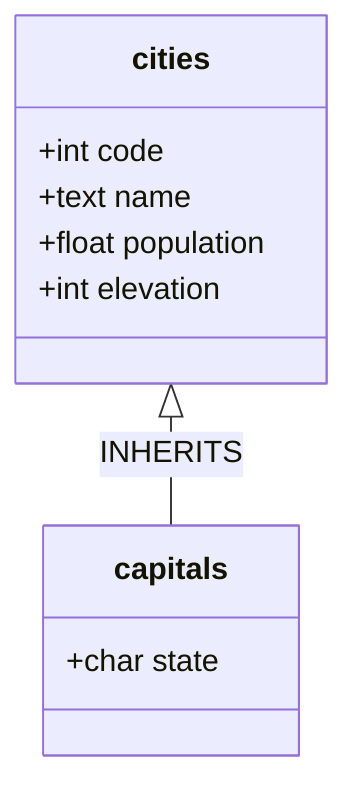

## 📋 Tabla Resumen del Capítulo 7

| Concepto | Palabra clave | Ejemplo de uso |
|---|---|---|
| Dominio | `CREATE DOMAIN` | Restringir enteros positivos |
| Tipo compuesto | `CREATE TYPE ... AS (...)` | Representar coordenadas, estructuras |
| Tipo enumerado | `CREATE TYPE ... AS ENUM (...)` | Estados, categorías fijas |
| Array | `tipo[]` | Listas de valores en una columna |
| Herencia | `INHERITS (tabla_padre)` | Especialización de entidades (capitales de ciudades) |

## 7.6. Actividades Propuestas

1. Modifica las tablas `dept` y `employee` de la base de datos `employees`, decidiendo qué campos son susceptibles de mejora mediante tipos avanzados (dominios, enumerados, etc.).
2. Realiza lo mismo con la base de datos `VTInstitute`.
3. A partir de un diagrama de clases que modele `Author` (Autor), `ArtWork` (Obra de Arte), `Painting` (Pintura) y `Sculpture` (Escultura) —donde `Painting` y `Sculpture` heredan de `ArtWork`—, crea la base de datos PostgreSQL correspondiente teniendo en cuenta:
   - El código de `Author` es una cadena formada por las iniciales del autor y el año de nacimiento.
   - El código de `ArtWork` debe ser una secuencia.
   - `width`, `height` y `weight` deben ser siempre valores mayores que cero.
   - `DimensionsType` debe implementarse como un tipo compuesto.

## ❓ Cuestionario de Autoevaluación — Capítulo 7

1. ¿Qué significan las siglas ORDBMS?
2. ¿Qué diferencia principal hay entre un ORDBMS y un OODBMS?
3. ¿Qué es un dominio (`DOMAIN`) en PostgreSQL?
4. ¿Por qué hay que usar paréntesis al acceder a un campo de un tipo compuesto en una consulta SQL?
5. ¿Cuál es el índice del primer elemento de un array en PostgreSQL?
6. ¿Qué palabra clave se usa para excluir las filas heredadas al consultar una tabla padre?
7. ¿Se heredan los índices en PostgreSQL al usar `INHERITS`?
8. Pon un ejemplo de riesgo derivado de un *cast* implícito mal diseñado.
9. ¿PostgreSQL admite herencia múltiple de tablas?
10. ¿Qué tipo de dato permite definir un conjunto fijo y ordenado de valores posibles, como días de la semana o estados?

### ✅ Respuestas

1. *Object-Relational Database Management System* (Sistema de Gestión de Bases de Datos Objeto-Relacional).
2. Un ORDBMS mantiene el modelo relacional como base, añadiendo soporte de objetos; un OODBMS es esencialmente un almacén persistente de objetos con poco soporte de consulta declarativa.
3. Un tipo de dato definido por el usuario basado en otro tipo, con restricciones opcionales (por ejemplo, `CHECK`) que limitan sus valores válidos.
4. Porque sin paréntesis, PostgreSQL interpreta el nombre antes del punto como una tabla, no como una columna de tipo compuesto.
5. El índice 1 (no 0, como en Java).
6. `ONLY` (por ejemplo, `SELECT * FROM ONLY cities`).
7. No, los índices (incluidas las claves primarias) no se heredan automáticamente.
8. Un *cast* implícito que convierte una expresión numérica en fecha podría insertar `'1976-01-01'` en lugar de `'2012-05-31'` si se omiten las comillas, sin lanzar error alguno.
9. Sí, a diferencia de Oracle, DB2 e Informix, que solo soportan herencia simple.
10. El tipo `ENUM` (tipo enumerado).

---
---

# PARTE IV — CONECTIVIDAD DESDE APLICACIONES

# Capítulo 8. JDBC: Conexión desde Java

## 8.1. Pasos generales para conectar con JDBC

**JDBC** (*Java Database Connectivity* — Conectividad a Bases de Datos desde Java) requiere tres pasos fundamentales:

1. **Registrar el driver JDBC**: la **JVM** (*Java Virtual Machine* — Máquina Virtual de Java) carga en memoria la implementación del driver.
2. **Formular la URL de la base de datos**: dirección que apunta a la base de datos deseada.
3. **Crear el objeto `Connection`**: mediante `DriverManager.getConnection()`.

### Diagrama: Pasos de conexión JDBC

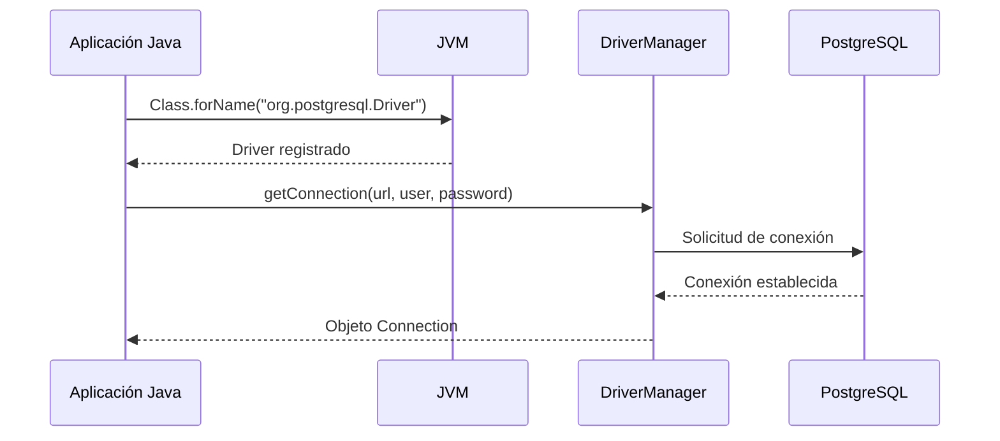

## 8.2. Registro del driver JDBC

### Opción 1: `Class.forName()`

```java
try {
    Class.forName("org.postgresql.Driver");
}
catch (ClassNotFoundException ex) {
    System.out.println("Error: unable to load driver class!");
    System.exit(1);
}
```

🔵 **INFORMACIÓN ADICIONAL**: Desde **JDBC 4.0**, cualquier driver compatible encontrado en el *classpath* se carga automáticamente, sin necesidad de `Class.forName()`. Para versiones anteriores, el registro manual es obligatorio.

### Opción 2: `DriverManager.registerDriver()`

Se recomienda esta alternativa cuando se usa una JVM no compatible con el estándar JDK (por ejemplo, la de Microsoft).

## 8.3. Formulación de la URL de conexión

| SGBD | Nombre del driver JDBC | Formato de URL |
|---|---|---|
| **PostgreSQL** | `org.postgresql.Driver` | `jdbc:postgresql://hostname:portNumber/databaseName` |
| **SQL Server** | `com.microsoft.sqlserver.jdbc.SQLServerDriver` | `jdbc:sqlserver://hostname:portNumber;database=databaseName;` |
| **MySQL** | `com.mysql.jdbc.Driver` | `jdbc:mysql://hostname/databaseName` |
| **ORACLE** | `oracle.jdbc.driver.OracleDriver` | `jdbc:oracle:thin:@hostname:portNumber:databaseName` |

## 8.4. Creación del objeto `Connection`

Existen tres formas de invocar `DriverManager.getConnection()`:

**Forma 1 — URL + usuario + contraseña separados:**

```java
String URL = "jdbc:postgresql://localhost:5432/VTInstitute";
String USER = "postgres";
String PASS = "pwd";
Connection conn = DriverManager.getConnection(URL, USER, PASS);
```

**Forma 2 — URL con credenciales incluidas:**

```java
String url = "jdbc:postgresql://localhost:5432/VTInstitute?user=postgres&password=pwd";
Connection conn = DriverManager.getConnection(url);
```

**Forma 3 — URL + objeto `Properties`:**

```java
String url = "jdbc:postgresql://localhost:5432/VTInstitute";
Properties props = new Properties();
props.setProperty("user", "postgres");
props.setProperty("password", "pwd");
Connection conn = DriverManager.getConnection(url, props);
```

## 8.5. Cierre de conexiones JDBC

🔴 **CRÍTICO**: Es obligatorio cerrar explícitamente toda conexión a la base de datos al finalizar su uso mediante `close()`. Confiar en el recolector de basura de Java (*garbage collector*) es una **mala práctica de programación**.

```java
import java.sql.Connection;
import java.sql.DriverManager;
import java.sql.SQLException;

public class ConnectionTest {
    public static void main(String[] args)
            throws ClassNotFoundException, SQLException {
        Connection conn = null;
        try {
            Class.forName("org.postgresql.Driver");
            String url = "jdbc:postgresql://localhost:5432/VTInstitute";
            String user = "postgres";
            String password = "pwd";
            conn = DriverManager.getConnection(url, user, password);
            System.out.println("Connection established!!!");
        }
        catch (ClassNotFoundException e) {
            System.out.println("Cannot load PostgreSQL Driver!!");
        }
        catch (SQLException e) {
            System.out.println("Connection couldn't be established!");
        }
        finally {
            if (conn != null)
                conn.close();
        }
    }
}
```

## 8.6. Statement: Enviando sentencias SQL

La interfaz `Statement` define los métodos para enviar sentencias SQL (*Structured Query Language*) y recibir datos de la base de datos.

```java
import java.sql.*;

public class ConsultaBD1 {
    public static void main(String[] args)
            throws ClassNotFoundException, SQLException {
        Class.forName("org.postgresql.Driver");
        String url = "jdbc:postgresql://localhost:5432/VTInstitute";
        String user = "postgres";
        String password = "pwd";
        Connection con = DriverManager.getConnection(url, user, password);
        Statement statement = con.createStatement();
        String SQLsentence = "SELECT * FROM subjects ORDER BY code";
        ResultSet rs = statement.executeQuery(SQLsentence);

        System.out.println("Code" + "\t" + "Name");
        System.out.println("--------------------------------------");
        while (rs.next()) {
            System.out.println(rs.getString(1) + "\t " + rs.getString(2));
        }
        rs.close();
        con.close();
    }
}
```

### Métodos clave de `Statement`

| Método | Retorno | Uso recomendado |
|---|---|---|
| `boolean execute(String SQL)` | `true` si hay `ResultSet` disponible | Sentencias DDL o SQL dinámico |
| `int executeUpdate(String SQL)` | Número de filas afectadas | `INSERT`, `UPDATE`, `DELETE` |
| `ResultSet executeQuery(String SQL)` | Un `ResultSet` | `SELECT` |

## 8.7. Cierre de recursos: buenas prácticas

Cerrar manualmente `ResultSet`, `Statement` y `Connection` en un bloque `finally` resulta engorroso:

```java
finally {
    if (rs != null) { try { rs.close(); } catch (SQLException e) { /* ignored */ } }
    if (st != null) { try { st.close(); } catch (SQLException e) { /* ignored */ } }
    if (conn != null) { try { conn.close(); } catch (SQLException e) { /* ignored */ } }
}
```

### Alternativa 1: Apache Commons DbUtils

```java
finally {
    DbUtils.closeQuietly(rs);
    DbUtils.closeQuietly(st);
    DbUtils.closeQuietly(conn);
}
```

### Alternativa 2: Try-with-resources (desde Java 7)

El bloque **try-with-resources** cierra automáticamente cualquier objeto que implemente `java.lang.AutoCloseable` (lo que incluye `java.io.Closeable`).

```java
static final String url = "jdbc:postgresql://localhost:5432/VTInstitute";
static final String user = "postgres";
static final String password = "pwd";

public static void main(String[] args)
        throws ClassNotFoundException, SQLException {
    try {
        Class.forName("org.postgresql.Driver");
    }
    catch (ClassNotFoundException e) {
        System.out.println("Cannot load PostgreSQL Driver!!");
    }

    try (Connection conn = DriverManager.getConnection(url, user, password)) {
        System.out.println("Connection established!!!");
    }
    catch (SQLException e) {
        System.out.println("Connection couldn't be established!");
    }
}
```

🟢 **BUENA PRÁCTICA**: El *try-with-resources* es la opción recomendada en proyectos modernos por su simplicidad y seguridad (garantiza el cierre incluso si ocurre una excepción).

## 8.8. PreparedStatement

`PreparedStatement` representa sentencias SQL **precompiladas**, ideales si la misma sentencia se ejecuta repetidamente (por ejemplo, dentro de un bucle).

```java
PreparedStatement pstmt = conn.prepareStatement(
    "INSERT INTO subjects (Name, Year) VALUES (?, ?)");
pstmt.setString(1, "Markup Languages");
pstmt.setInt(2, 1);
pstmt.executeUpdate();
```

### Comparativa: Statement vs. PreparedStatement

| Statement | PreparedStatement |
|---|---|
| Acceso general mediante SQL estático | Ejecuta sentencias SQL precompiladas |
| No admite parámetros en tiempo de ejecución | Admite parámetros (`?`) en tiempo de ejecución |
| No acepta parámetros de entrada | Es una sentencia parametrizada (admite parámetros `IN`) |
| Vulnerable a inyección SQL | **Resistente a inyección SQL** (escapa caracteres especiales) |
| Sin protocolo binario propio | Usa un protocolo binario no-SQL, más eficiente |
| Ideal para DDL (`CREATE`, `DROP`, `ALTER`) | Ideal para DML (`SELECT`, `UPDATE`, `INSERT`) |

🟢 **BUENA PRÁCTICA**: `PreparedStatement` permite insertar tipos de datos no estándar directamente, como `Timestamp` o `InputStream`:

```java
ps = connection.prepareStatement("INSERT INTO books (cover_photo) VALUES (?)");
ps.setBinaryStream(1, book.getPhoto());
ps.executeUpdate();
```

### Métodos más usados de PreparedStatement

| Método | Descripción |
|---|---|
| `setInt(int paramIndex, int value)` | Asigna un valor entero al parámetro indicado |
| `setString(int paramIndex, String value)` | Asigna una cadena al parámetro indicado |
| `setFloat(int paramIndex, float value)` | Asigna un valor flotante |
| `setDouble(int paramIndex, double value)` | Asigna un valor doble |
| `executeUpdate()` | Ejecuta `INSERT`, `UPDATE`, `DELETE` |
| `executeQuery()` | Ejecuta `SELECT`, devuelve un `ResultSet` |

## 8.9. CallableStatement: Invocando procedimientos almacenados

`CallableStatement` permite invocar desde Java las funciones y procedimientos PL/pgSQL definidos en el Capítulo 6.

```java
import java.sql.*;

public class App {
    static final String url = "jdbc:postgresql://localhost:5432/VTInstitute";
    static final String user = "postgres";
    static final String password = "pwd";

    public static void main(String[] args)
            throws ClassNotFoundException, SQLException {
        try (Connection conn = DriverManager.getConnection(url, user, password)) {
            CallableStatement statement = conn.prepareCall("{call listofsubjects(1)}");
            ResultSet rs = statement.executeQuery();
            System.out.println("Code" + "\t" + "Name");
            System.out.println("--------------------------------------");
            while (rs.next()) {
                System.out.println(rs.getString(1) + "\t " + rs.getString(2));
            }
        }
        catch (SQLException e) {
            e.printStackTrace();
        }
    }
}
```

🟡 **ATENCIÓN**: Para invocar un **procedimiento** (no una función), se omiten las llaves de la llamada:

```java
CallableStatement statement = conn.prepareCall("call doSomething()");
```

### Diagrama: Jerarquía de interfaces JDBC

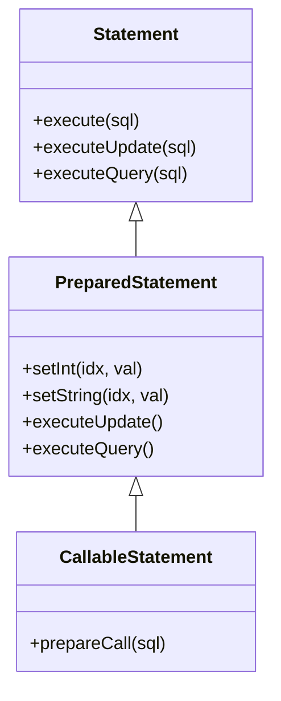

## 📋 Tabla Resumen del Capítulo 8

| Elemento JDBC | Finalidad |
|---|---|
| `DriverManager` | Gestiona el registro de drivers y crea conexiones |
| `Connection` | Representa la sesión activa con la base de datos |
| `Statement` | Ejecuta SQL estático |
| `PreparedStatement` | Ejecuta SQL parametrizado y precompilado |
| `CallableStatement` | Invoca procedimientos/funciones almacenadas |
| `ResultSet` | Representa el conjunto de filas devuelto por una consulta |
| *try-with-resources* | Cierre automático y seguro de recursos |

## 8.10. Actividades Propuestas

1. Crear un proyecto Maven con IntelliJ IDEA para ejecutar la aplicación de consulta mostrada en este capítulo, añadiendo la dependencia de PostgreSQL al `pom.xml`. Modificar la aplicación para mostrar también el año de cada asignatura, añadiendo control de errores (`try...catch`).
2. Usando `executeUpdate`, modificar la aplicación anterior para insertar una nueva asignatura, mostrando el valor devuelto.
3. Reescribir los ejercicios anteriores empleando `PreparedStatement` en lugar de `Statement`, permitiendo al usuario introducir varias asignaturas mediante un bucle con una señal de parada.
4. Usando la base de datos `employees`, crear una aplicación Java que permita invocar los procedimientos almacenados definidos en el Capítulo 6.

## ❓ Cuestionario de Autoevaluación — Capítulo 8

1. ¿Qué tres pasos son necesarios para establecer una conexión JDBC?
2. ¿Qué método se usa tradicionalmente para registrar un driver JDBC?
3. ¿Cuál es el formato general de una URL JDBC para PostgreSQL?
4. ¿Qué diferencia hay entre `executeQuery()` y `executeUpdate()`?
5. ¿Por qué `PreparedStatement` es más seguro que `Statement` frente a ataques de inyección SQL?
6. ¿Qué ventaja ofrece el bloque *try-with-resources* frente al uso manual de `finally`?
7. ¿Qué interfaz de JDBC se usa para invocar un procedimiento almacenado?
8. ¿Cómo se escribe la llamada JDBC para invocar una función llamada `listofsubjects` con el parámetro `1`?
9. ¿Qué biblioteca externa simplifica el cierre de recursos JDBC con una sola línea por objeto?
10. ¿Qué ocurre si no cerramos explícitamente una conexión JDBC?

### ✅ Respuestas

1. Registrar el driver, formular la URL de la base de datos y crear el objeto `Connection`.
2. `Class.forName("org.postgresql.Driver")`.
3. `jdbc:postgresql://hostname:portNumber/databaseName`.
4. `executeQuery()` se usa para `SELECT` y devuelve un `ResultSet`; `executeUpdate()` se usa para `INSERT`, `UPDATE` o `DELETE` y devuelve el número de filas afectadas.
5. Porque escapa automáticamente los caracteres especiales (comillas, etc.), evitando que el usuario inyecte código SQL malicioso.
6. Garantiza el cierre automático de los recursos (`AutoCloseable`) incluso si ocurre una excepción, sin necesidad de escribir bloques `finally` extensos.
7. `CallableStatement`.
8. `conn.prepareCall("{call listofsubjects(1)}")`.
9. Apache Commons DbUtils (método `DbUtils.closeQuietly()`).
10. Eventualmente el recolector de basura de Java la cerrará, pero esto es una mala práctica que puede agotar las conexiones disponibles del servidor antes de que ocurra.

---

# Capítulo 9. Transacciones y Buenas Prácticas

## 9.1. ¿Qué es una transacción?

Una **transacción** es una unidad lógica de trabajo que se ejecuta de forma independiente para leer o modificar datos. Si la transacción tiene éxito, todos los cambios se confirman (`COMMIT`) y pasan a formar parte permanente de la base de datos. Si ocurre un error, todos los cambios se deshacen (`ROLLBACK`).

## 9.2. Propiedades ACID

| Propiedad | Significado | Explicación |
|---|---|---|
| **Atomicity** (Atomicidad) | Todo o nada | Una transacción se ejecuta completamente o no se ejecuta en absoluto |
| **Consistency** (Consistencia) | Estado válido | La base de datos pasa de un estado consistente a otro estado consistente |
| **Isolation** (Aislamiento) | Independencia | Transacciones concurrentes no se interfieren entre sí |
| **Durability** (Durabilidad) | Persistencia | Los cambios confirmados sobreviven a fallos del sistema |

### Diagrama: Ejemplo clásico — transferencia bancaria

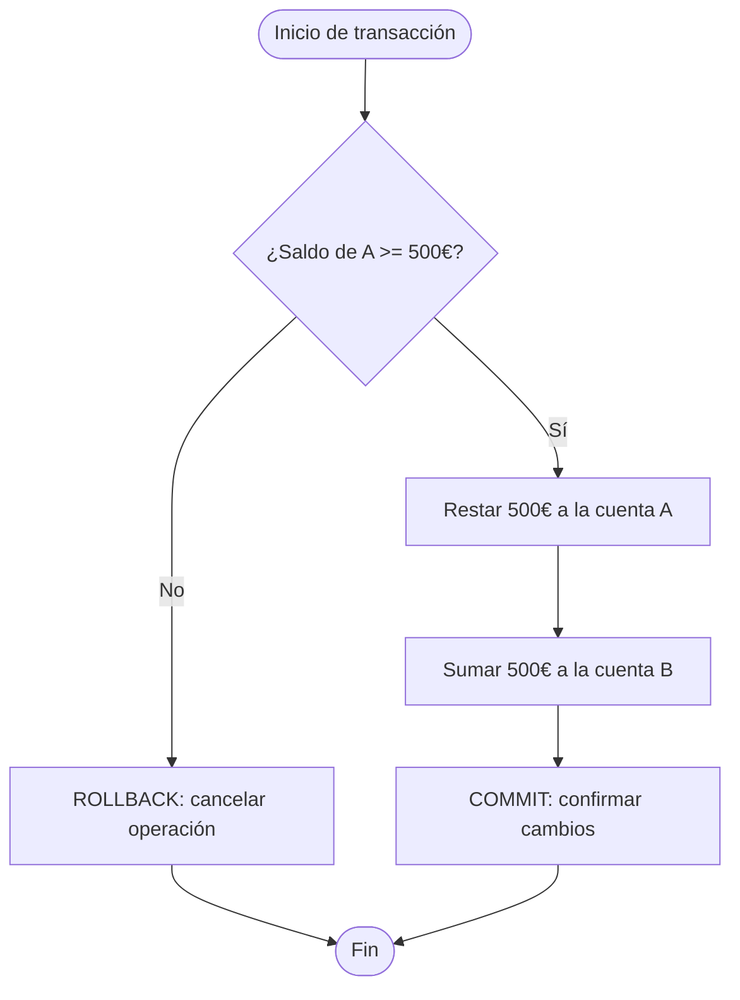

🔴 **CRÍTICO**: Si el proceso falla entre la resta a la cuenta A y la suma a la cuenta B **sin usar una transacción**, el dinero "desaparece" del sistema. Las transacciones existen precisamente para evitar este tipo de inconsistencias.

## 9.3. Transacciones en SQL

```sql
BEGIN;
-- Operaciones...
COMMIT;    -- Confirma los cambios
-- o bien:
ROLLBACK;  -- Deshace los cambios
```

## 9.4. Transacciones en JDBC

Por defecto, JDBC trabaja en modo **auto-commit**, confirmando cada sentencia individualmente. Para gestionar transacciones manualmente:

```java
try (Connection conn = DriverManager.getConnection(url, user, password)) {
    conn.setAutoCommit(false);
    try {
        PreparedStatement st = conn.prepareStatement(
            "INSERT INTO courses(name) VALUES(?)",
            Statement.RETURN_GENERATED_KEYS);
        st.setString(1, "Computer Systems Administration");
        st.executeUpdate();

        ResultSet keys = st.getGeneratedKeys();
        keys.next();
        int courseCode = keys.getInt(1);

        PreparedStatement st2 = conn.prepareStatement(
            "INSERT INTO subjects(name, year, course) VALUES (?, ?, ?)");
        st2.setString(1, "CyberSecurity");
        st2.setInt(2, 2);
        st2.setInt(3, courseCode);
        st2.executeUpdate();

        System.out.println("Transaction finished successfully!!");
        conn.commit();
    }
    catch (SQLException ex) {
        System.err.println(ex.getMessage());
        conn.rollback();
    }
}
```

🔵 **INFORMACIÓN ADICIONAL**: `Statement.RETURN_GENERATED_KEYS` permite recuperar las claves autogeneradas (normalmente valores `SERIAL`) tras una operación `INSERT`, muy útil cuando necesitamos ese valor para insertar registros relacionados dentro de la misma transacción.

### Diagrama: Ciclo de una transacción en JDBC

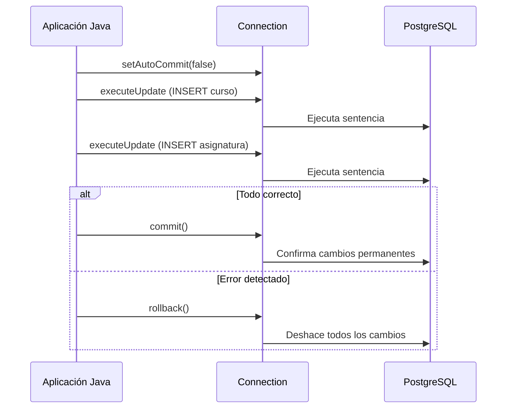

## 📋 Tabla Resumen del Capítulo 9

| Concepto | Palabra clave SQL | Método JDBC |
|---|---|---|
| Confirmar cambios | `COMMIT` | `conn.commit()` |
| Deshacer cambios | `ROLLBACK` | `conn.rollback()` |
| Desactivar auto-commit | — | `conn.setAutoCommit(false)` |
| Recuperar claves generadas | — | `Statement.RETURN_GENERATED_KEYS` |

## 9.5. Actividades Propuestas

1. Usando la base de datos `employees`, crear una aplicación Java que inserte un nuevo empleado en un departamento. Si el departamento no existe, debe crearse. La inserción debe ser **transaccional**: si la creación del departamento falla, debe revertirse también la inserción del empleado.

## ❓ Cuestionario de Autoevaluación — Capítulo 9

1. ¿Qué significan las siglas ACID?
2. Explica con tus palabras la propiedad de "Aislamiento" (*Isolation*).
3. ¿Qué sentencia SQL confirma permanentemente los cambios de una transacción?
4. ¿Qué sentencia SQL deshace los cambios de una transacción no confirmada?
5. ¿Cuál es el modo de confirmación por defecto en JDBC?
6. ¿Qué método de `Connection` se usa para desactivar el modo auto-commit?
7. ¿Para qué sirve `Statement.RETURN_GENERATED_KEYS`?
8. En el ejemplo bancario, ¿qué podría pasar si no se usa una transacción y el sistema falla a mitad de la operación?
9. ¿Qué nombre recibe un SGBD que soporta transacciones?
10. ¿Qué bloque de código Java se usa habitualmente para capturar errores y ejecutar `rollback()`?

### ✅ Respuestas

1. Atomicity, Consistency, Isolation, Durability (Atomicidad, Consistencia, Aislamiento, Durabilidad).
2. Cada transacción se ejecuta como si fuera la única en el sistema, sin verse afectada por otras transacciones concurrentes.
3. `COMMIT`.
4. `ROLLBACK`.
5. Auto-commit activado (`true`): cada sentencia se confirma automáticamente.
6. `conn.setAutoCommit(false)`.
7. Permite recuperar las claves (normalmente autogeneradas, como `SERIAL`) producidas tras una operación `INSERT`.
8. El dinero podría "perderse": restarse de una cuenta sin llegar a sumarse en la otra.
9. "Transaccional".
10. Un bloque `try { ... } catch (SQLException ex) { conn.rollback(); }`.

---
---

# PARTE V — ADMINISTRACIÓN Y HERRAMIENTAS

# Capítulo 10. Herramientas Gráficas: PgAdmin4 e IntelliJ IDEA

## 10.1. PgAdmin4

**PgAdmin4** es la herramienta gráfica oficial de administración de PostgreSQL. Permite:

- Crear y administrar bases de datos, esquemas y tablas sin escribir SQL manualmente.
- Ejecutar consultas SQL mediante el **Query Tool**.
- Crear funciones y procedimientos mediante asistentes visuales (pestañas *General*, *Definition*, *Code*, *Options*, *Parameters*, *Security*, *SQL*).
- Visualizar el SQL generado automáticamente antes de aplicarlo.

## 10.2. Gestión de bases de datos desde IntelliJ IDEA

Aunque PgAdmin4 es la herramienta "nativa" recomendada, el **IDE** (*Integrated Development Environment* — Entorno de Desarrollo Integrado) **IntelliJ IDEA** incorpora una ventana de herramientas llamada **Database**, que permite conectar con prácticamente cualquier SGBD popular sin salir del entorno de programación.

### Pasos para conectar IntelliJ IDEA con PostgreSQL

1. Abrir la ventana **Database** → pulsar el botón `+`.
2. Elegir `Data Source` → `PostgreSQL`.
3. Rellenar host, puerto, usuario, contraseña y nombre de la base de datos.
4. Una vez conectado, el árbol de esquemas, tablas, rutinas y secuencias aparece disponible para su exploración.
5. Desde el menú contextual es posible crear tablas, vistas, procedimientos (`New → Table / Routine / Sequence...`).
6. La **Query Console** permite lanzar sentencias SQL directamente, mostrando los resultados en una tabla interactiva.

### Diagrama: Flujo de trabajo con la ventana Database de IntelliJ IDEA

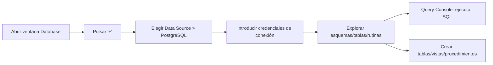

🟢 **BUENA PRÁCTICA**: Usar la integración de base de datos de IntelliJ IDEA agiliza el ciclo de desarrollo, ya que permite inspeccionar el esquema sin cambiar de aplicación mientras se programa en Java.

## 📋 Tabla Resumen del Capítulo 10

| Herramienta | Uso principal |
|---|---|
| PgAdmin4 | Administración completa y nativa de PostgreSQL |
| IntelliJ IDEA (ventana Database) | Gestión integrada sin salir del IDE durante el desarrollo |
| Query Tool / Query Console | Ejecución directa de sentencias SQL |

## ❓ Cuestionario de Autoevaluación — Capítulo 10

1. ¿Qué es PgAdmin4?
2. ¿Qué pestañas utiliza el asistente de PgAdmin4 para crear una función?
3. ¿Qué significan las siglas IDE?
4. ¿Qué ventana de IntelliJ IDEA permite conectar con bases de datos?
5. ¿Qué botón se usa en IntelliJ IDEA para añadir una nueva conexión de base de datos?
6. ¿Qué ventaja ofrece gestionar la base de datos desde el propio IDE?
7. ¿Qué herramienta de PgAdmin4 permite ejecutar sentencias SQL manualmente?
8. ¿Es posible crear tablas desde IntelliJ IDEA sin escribir SQL manualmente?
9. ¿Qué información se solicita al configurar una nueva conexión a PostgreSQL?
10. ¿Qué nombre recibe la consola de SQL dentro de IntelliJ IDEA?

### ✅ Respuestas

1. La herramienta gráfica oficial de administración de PostgreSQL.
2. *General*, *Definition*, *Code*, *Options*, *Parameters*, *Security* y *SQL*.
3. *Integrated Development Environment* (Entorno de Desarrollo Integrado).
4. La ventana **Database**.
5. El botón `+`.
6. Permite inspeccionar y modificar el esquema de la base de datos sin cambiar de aplicación mientras se programa.
7. El **Query Tool**.
8. Sí, mediante el menú contextual `New → Table`.
9. Host, puerto, usuario, contraseña y nombre de la base de datos.
10. **Query Console**.

---

# Capítulo 11. Seguridad, Rendimiento y Buenas Prácticas Profesionales

## 11.1. Seguridad: prevención de inyección SQL

La **inyección SQL** es una técnica de ataque donde un usuario malicioso introduce fragmentos de código SQL en campos de entrada para alterar el comportamiento de una consulta.

🔴 **CRÍTICO — Ejemplo de código vulnerable:**

```java
// NUNCA concatenar directamente la entrada del usuario
String sql = "SELECT * FROM users WHERE name = '" + userInput + "'";
```

Si `userInput` contiene `' OR '1'='1`, la consulta final sería:

```sql
SELECT * FROM users WHERE name = '' OR '1'='1'
```

...devolviendo **todos** los registros de la tabla, incluso sin conocer ninguna contraseña.

🟢 **BUENA PRÁCTICA — Solución con PreparedStatement:**

```java
PreparedStatement ps = conn.prepareStatement("SELECT * FROM users WHERE name = ?");
ps.setString(1, userInput);
```

`PreparedStatement` escapa automáticamente los caracteres peligrosos, neutralizando el ataque.

## 11.2. Checklist de buenas prácticas profesionales

| # | Buena práctica | Motivo |
|---|---|---|
| 1 | Usar `PreparedStatement` en lugar de `Statement` para SQL con parámetros | Previene inyección SQL |
| 2 | Cerrar siempre los recursos (`try-with-resources`) | Evita fugas de conexiones |
| 3 | Usar transacciones (`commit`/`rollback`) en operaciones múltiples relacionadas | Garantiza consistencia (ACID) |
| 4 | Usar procedimientos almacenados para lógica compleja | Mejora seguridad y rendimiento |
| 5 | Indexar columnas usadas frecuentemente en `WHERE`/`JOIN` | Mejora el rendimiento de las consultas |
| 6 | No almacenar contraseñas en texto plano en el código fuente | Seguridad de credenciales |
| 7 | Validar restricciones (`NOT NULL`, `CHECK`, `FOREIGN KEY`) a nivel de base de datos | Integridad independiente de la aplicación |
| 8 | Usar vistas para simplificar consultas repetitivas complejas | Abstracción y mantenibilidad |
| 9 | Evitar `SELECT *` en producción | Rendimiento y claridad del código |
| 10 | Documentar procedimientos almacenados y esquemas | Mantenibilidad a largo plazo |

## 11.3. Rendimiento básico

- Los **índices** aceleran lecturas, pero ralentizan ligeramente las escrituras: hay que buscar equilibrio.
- Evitar transacciones demasiado largas, ya que bloquean recursos y afectan a la concurrencia.
- Usar `EXPLAIN` / `EXPLAIN ANALYZE` en PostgreSQL para estudiar el plan de ejecución de una consulta antes de optimizarla.

```sql
EXPLAIN ANALYZE SELECT * FROM subjects WHERE year = 1;
```

### Diagrama: Pirámide de buenas prácticas

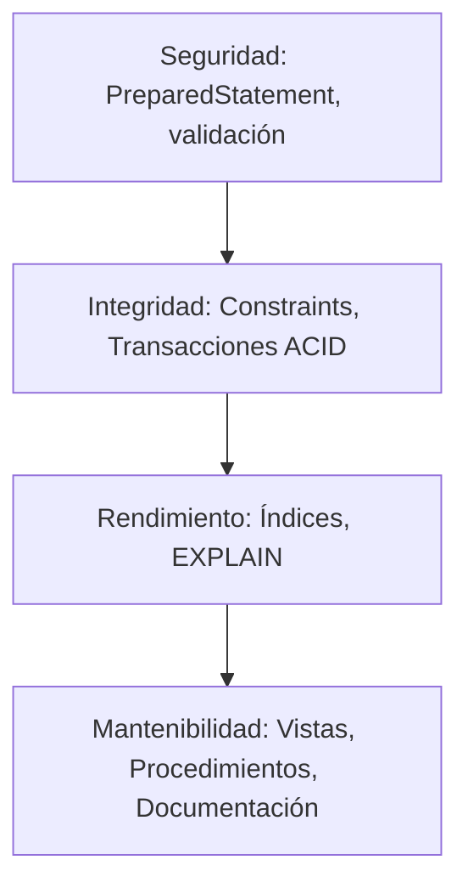

## 📋 Tabla Resumen del Capítulo 11

| Riesgo | Mitigación |
|---|---|
| Inyección SQL | `PreparedStatement` / `CallableStatement` |
| Fugas de conexión | *try-with-resources* / DbUtils |
| Inconsistencia de datos | Transacciones ACID |
| Consultas lentas | Índices + `EXPLAIN ANALYZE` |
| Código no mantenible | Vistas y procedimientos almacenados documentados |

## ❓ Cuestionario de Autoevaluación — Capítulo 11

1. ¿Qué es la inyección SQL?
2. ¿Qué objeto JDBC previene eficazmente la inyección SQL?
3. Escribe un ejemplo de entrada maliciosa que explote una consulta SQL mal construida.
4. ¿Qué comando de PostgreSQL permite analizar el plan de ejecución de una consulta?
5. ¿Por qué se recomienda evitar `SELECT *` en entornos de producción?
6. ¿Qué ventaja de mantenibilidad ofrecen las vistas?
7. ¿Qué pasa si una transacción se mantiene abierta demasiado tiempo?
8. ¿Dónde deben aplicarse las restricciones de integridad para mayor seguridad: solo en la aplicación o también en la base de datos?
9. Nombra dos buenas prácticas relacionadas directamente con el cierre de recursos.
10. ¿Qué relación existe entre los índices y el rendimiento de escritura en una tabla?

### ✅ Respuestas

1. Una técnica de ataque que introduce fragmentos de código SQL malicioso a través de entradas de usuario no validadas, alterando el comportamiento de las consultas.
2. `PreparedStatement` (y por extensión `CallableStatement`).
3. `' OR '1'='1` (u otras variantes que alteren la lógica de la cláusula `WHERE`).
4. `EXPLAIN` o `EXPLAIN ANALYZE`.
5. Porque recupera columnas innecesarias, afecta al rendimiento y dificulta la lectura/mantenimiento del código.
6. Permiten abstraer consultas complejas reutilizables, simplificando el código de la aplicación y facilitando cambios futuros en el modelo físico.
7. Puede bloquear recursos compartidos, afectando a la concurrencia y al rendimiento general del sistema.
8. En ambos niveles: la aplicación debe validar, pero las restricciones en la base de datos garantizan integridad independientemente del cliente que acceda a los datos.
9. Usar *try-with-resources* y/o bibliotecas como Apache Commons DbUtils para cerrar `ResultSet`, `Statement` y `Connection`.
10. Los índices aceleran las lecturas, pero ralentizan ligeramente las operaciones de escritura (`INSERT`, `UPDATE`, `DELETE`), ya que también deben actualizarse.

---
---

# 📖 Capítulo 12. Glosario General de Términos

| Término | Definición |
|---|---|
| **ACID** | *Atomicity, Consistency, Isolation, Durability* (Atomicidad, Consistencia, Aislamiento, Durabilidad) — propiedades que garantizan transacciones fiables |
| **API** | *Application Programming Interface* (Interfaz de Programación de Aplicaciones) — conjunto de reglas que permite a dos programas comunicarse |
| **Array** | Tipo de dato que almacena una colección ordenada de valores en una sola columna |
| **Atomicidad** | Propiedad ACID que exige que una transacción se ejecute completamente o no se ejecute en absoluto |
| **Auto-commit** | Modo de JDBC en el que cada sentencia se confirma automáticamente de forma individual |
| **CallableStatement** | Interfaz JDBC usada para invocar procedimientos y funciones almacenadas |
| **Cast** | Conversión explícita o implícita de un tipo de dato a otro |
| **Clave foránea (FK)** | *Foreign Key* — columna que referencia la clave primaria de otra tabla, garantizando integridad referencial |
| **Clave primaria (PK)** | *Primary Key* — columna (o conjunto de columnas) que identifica de forma única cada fila de una tabla |
| **COMMIT** | Sentencia SQL que confirma de forma permanente los cambios de una transacción |
| **Composite Type** | Tipo compuesto — estructura de datos definida por una lista de campos con sus tipos, similar a una fila |
| **Conector (Driver)** | Software que permite a una aplicación comunicarse con un SGBD específico |
| **Connection** | Objeto JDBC que representa una sesión activa con la base de datos |
| **Consistencia** | Propiedad ACID que garantiza que la base de datos pase de un estado válido a otro estado válido |
| **CRUD** | *Create, Read, Update, Delete* (Crear, Leer, Actualizar, Eliminar) — las cuatro operaciones básicas de persistencia |
| **DBMS / SGBD** | *Database Management System* / Sistema de Gestión de Bases de Datos — software que administra el acceso a los datos |
| **DCL** | *Data Control Language* (Lenguaje de Control de Datos) — subconjunto SQL para permisos (`GRANT`, `REVOKE`) |
| **DDL** | *Data Definition Language* (Lenguaje de Definición de Datos) — subconjunto SQL para definir estructuras (`CREATE`, `ALTER`, `DROP`) |
| **DML** | *Data Manipulation Language* (Lenguaje de Manipulación de Datos) — subconjunto SQL para manejar datos (`SELECT`, `INSERT`, `UPDATE`, `DELETE`) |
| **Dominio (DOMAIN)** | Tipo de dato definido por el usuario basado en otro tipo, con restricciones opcionales |
| **DriverManager** | Clase de JDBC encargada de gestionar los drivers registrados y crear conexiones |
| **Durabilidad** | Propiedad ACID que garantiza que los cambios confirmados persistan incluso ante fallos del sistema |
| **Enum (tipo enumerado)** | Tipo de dato que define un conjunto fijo y ordenado de valores posibles |
| **Función (Stored Function)** | Rutina almacenada en la base de datos que obligatoriamente devuelve un valor |
| **IDE** | *Integrated Development Environment* (Entorno de Desarrollo Integrado), como IntelliJ IDEA |
| **Índice (INDEX)** | Estructura auxiliar que acelera la búsqueda de filas en una tabla |
| **Inyección SQL** | Ataque que introduce código SQL malicioso a través de entradas no validadas |
| **Aislamiento (Isolation)** | Propiedad ACID que garantiza que las transacciones concurrentes no se interfieran entre sí |
| **JDBC** | *Java Database Connectivity* (Conectividad a Bases de Datos desde Java) — API estándar de Java para acceder a bases de datos |
| **JOIN** | Operación SQL que combina filas de dos o más tablas según una condición de relación |
| **JVM** | *Java Virtual Machine* (Máquina Virtual de Java) — entorno de ejecución de programas Java |
| **ODBC** | *Open Database Connectivity* (Conectividad Abierta a Bases de Datos) — estándar de conexión usado en C, C++, C#, Visual Basic |
| **OODBMS** | *Object-Oriented Database Management System* (Sistema de Gestión de Bases de Datos Orientado a Objetos) |
| **ORD / ORDBMS** | *Object-Relational Database (Management System)* — Base de Datos (Sistema Gestor) Objeto-Relacional |
| **PgAdmin4** | Herramienta gráfica oficial de administración de PostgreSQL |
| **PL/pgSQL** | *Procedural Language/PostgreSQL* — lenguaje procedimental propio de PostgreSQL para funciones y procedimientos |
| **Polimorfismo** | Capacidad de un sistema de tratar distintos tipos de datos mediante una interfaz común (incluye *casting* en PostgreSQL) |
| **POO** | Programación Orientada a Objetos |
| **PostgreSQL / Postgres** | Sistema de gestión de bases de datos relacional y objeto-relacional, libre y de código abierto |
| **PreparedStatement** | Interfaz JDBC para ejecutar sentencias SQL precompiladas y parametrizadas, resistentes a inyección SQL |
| **Procedimiento (Stored Procedure)** | Rutina almacenada en la base de datos que no está obligada a devolver un valor |
| **RDBMS** | *Relational Database Management System* (Sistema de Gestión de Bases de Datos Relacionales) |
| **ResultSet** | Objeto JDBC que representa el conjunto de filas devuelto por una consulta `SELECT` |
| **ROLLBACK** | Sentencia SQL que deshace los cambios de una transacción no confirmada |
| **Secuencia (SEQUENCE)** | Objeto de PostgreSQL que genera valores numéricos incrementales, base del tipo `SERIAL` |
| **SERIAL** | Pseudo-tipo de PostgreSQL que crea una secuencia asociada para generar valores autoincrementales |
| **SGBD** | Ver **DBMS** |
| **SQL** | *Structured Query Language* (Lenguaje de Consulta Estructurado) — lenguaje estándar para gestionar bases de datos relacionales |
| **Statement** | Interfaz JDBC básica para enviar sentencias SQL estáticas |
| **TCL** | *Transaction Control Language* (Lenguaje de Control de Transacciones) — incluye `COMMIT` y `ROLLBACK` |
| **Transacción** | Unidad lógica de trabajo que se ejecuta de forma íntegra (todo o nada) sobre la base de datos |
| **Try-with-resources** | Estructura de Java (desde la versión 7) que cierra automáticamente los recursos `AutoCloseable` |
| **Vista (VIEW)** | Consulta almacenada que se comporta como una tabla virtual |
| **Vista materializada** | Vista cuyo resultado se almacena físicamente y debe actualizarse de forma explícita |

---

# 🎯 Capítulo 13. Resumen Ejecutivo Final

Este manual ha recorrido el ciclo completo de aprendizaje de **PostgreSQL**, desde los fundamentos conceptuales hasta su uso profesional en aplicaciones Java mediante **JDBC** (*Java Database Connectivity*).

### Ideas clave que debes recordar

1. **PostgreSQL es un RDBMS (Relational Database Management System) libre, multiplataforma y extensible**, que además ofrece capacidades propias de un **ORDBMS (Object-Relational Database Management System)**: tipos personalizados, herencia de tablas y polimorfismo controlado.

2. **SQL se organiza en subconjuntos claros**: DDL para definir estructuras, DML para manipular datos, DCL para permisos y TCL para transacciones. Dominar `CREATE`, `SELECT`, `INSERT`, `UPDATE`, `DELETE`, `JOIN` y las funciones de agregación constituye la base indispensable de cualquier desarrollador que trabaje con datos.

3. **Las vistas, los procedimientos almacenados (PL/pgSQL) y los tipos avanzados (dominios, tipos compuestos, enumerados, arrays)** permiten llevar la lógica de negocio más cerca de los datos, mejorando seguridad, rendimiento y mantenibilidad.

4. **La conexión desde Java se realiza mediante JDBC**, siguiendo siempre tres pasos: registrar el driver, formular la URL y crear la conexión. El uso de `PreparedStatement` y `CallableStatement` no es opcional en entornos profesionales: es la **barrera principal contra la inyección SQL**.

5. **Las transacciones (propiedades ACID)** son el mecanismo que garantiza que operaciones compuestas por varios pasos (por ejemplo, insertar un curso y luego una asignatura relacionada) se completen íntegramente o se reviertan por completo, evitando estados inconsistentes en la base de datos.

6. **La gestión correcta de recursos** (`try-with-resources`, bibliotecas como Apache Commons DbUtils) previene fugas de memoria y conexiones colgadas, un error extremadamente común en aplicaciones principiantes.

7. **Las herramientas gráficas (PgAdmin4, IntelliJ IDEA)** aceleran el desarrollo y la administración, pero el conocimiento profundo del SQL subyacente sigue siendo imprescindible para depurar, optimizar y asegurar cualquier sistema de persistencia.

### 🧭 Ruta de progresión recomendada para el lector

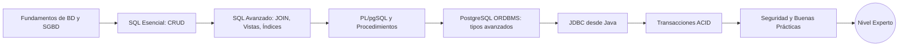

> 🏁 **Mensaje final**: Dominar PostgreSQL no consiste solo en memorizar sintaxis SQL, sino en comprender **por qué** existen conceptos como las transacciones, los índices o los procedimientos almacenados: todos ellos resuelven problemas reales de integridad, seguridad y rendimiento que todo programador profesional encontrará en su carrera.

---

# 📚 Capítulo 14. Bibliografía y Recursos Oficiales

### Manuales oficiales en PDF (formato A4)

| Versión | Enlace |
|---|---|
| PostgreSQL 19 Beta 4 | https://www.postgresql.org/files/documentation/pdf/19/postgresql-19-A4.pdf |
| PostgreSQL 18 | https://www.postgresql.org/files/documentation/pdf/18/postgresql-18-A4.pdf |
| PostgreSQL 17 | https://www.postgresql.org/files/documentation/pdf/17/postgresql-17-A4.pdf |
| PostgreSQL 16 | https://www.postgresql.org/files/documentation/pdf/16/postgresql-16-A4.pdf |
| PostgreSQL 15 | https://www.postgresql.org/files/documentation/pdf/15/postgresql-15-A4.pdf |
| PostgreSQL 14 | https://www.postgresql.org/files/documentation/pdf/14/postgresql-14-A4.pdf |

*(Consulta el archivo histórico completo en: https://www.postgresql.org/docs/manuals/archive/ para versiones desde la 8.0 hasta la 13).*

### Documentación online

- PostgreSQL Documentation: https://www.postgresql.org/docs/
- Tutorial oficial: https://www.postgresql.org/docs/current/tutorial.html
- Primeros pasos: https://www.postgresql.org/docs/current/tutorial-start.html
- Instalación: https://www.postgresql.org/docs/current/tutorial-install.html
- Creación de bases de datos: https://www.postgresql.org/docs/current/tutorial-createdb.html
- Vistas: https://www.postgresql.org/docs/current/tutorial-views.html
- Guía de formatos de documentación: https://www.postgresql.org/docs/9.6/docguide.html

### Fuente académica base de este manual

- García Sevilla, J. R. *Unit 3 – Persistence in Databases. Connectors.* IES Mare Nostrum. Módulo de Acceso a Datos (Data Access), Ciclo Formativo de Grado Superior en Desarrollo de Aplicaciones Multiplataforma/Web. Licencia Creative Commons BY-NC-SA.

### Recursos complementarios recomendados

- JDBC Oracle Official Guide.
- The PostgreSQL™ JDBC Interface (documentación del driver pgJDBC).
- PostgreSQL JDBC error codes (referencia de códigos de error).
- Documentación de Apache Commons DbUtils.

---

### 🏆 Fin del Manual — PostgreSQL de Cero a Experto
*Elaborado con fines didácticos para programadores principiantes.*

